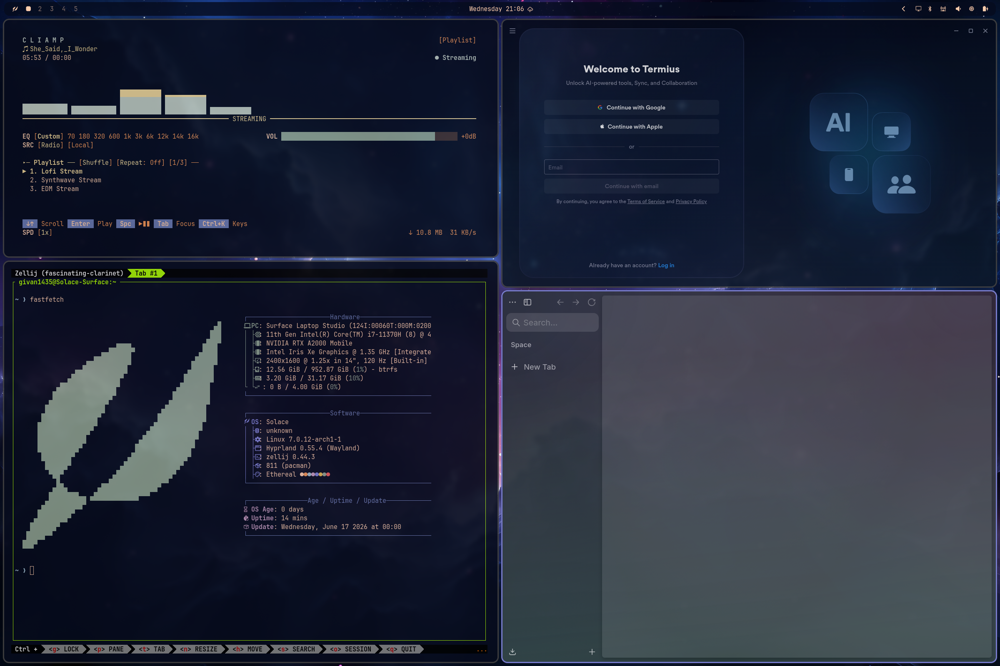
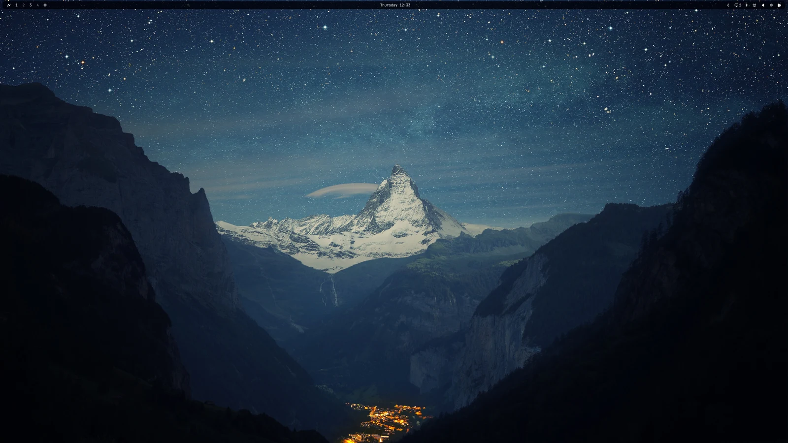
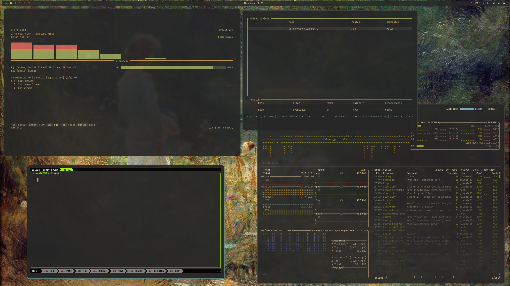
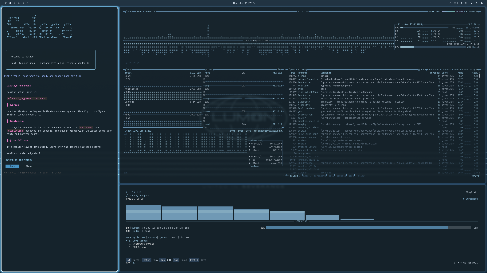
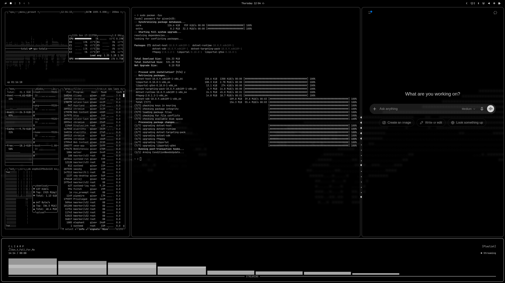
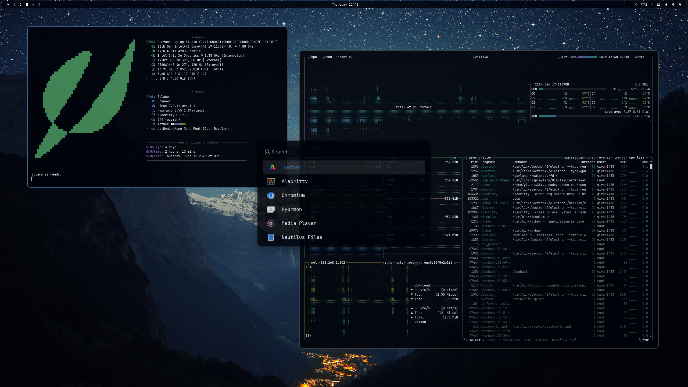
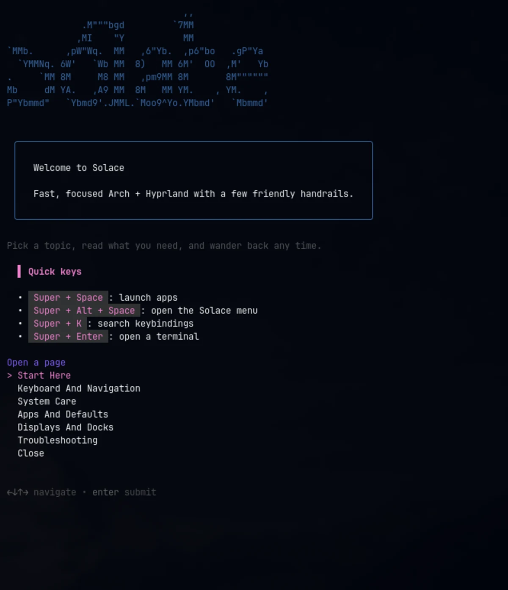

# Solace

Solace is a personal Arch Linux + Hyprland bootstrap/configuration repo.

The project tracks the parts of my preferred clean Hyprland workflow without tying the setup to a specific distro overlay or third-party mirrors. Solace configures a normal upstream Arch install into a Hyprland workstation environment.

For ISO testing and alpha release installs, read the [Solace Alpha Install Guide](docs/ALPHA_INSTALL.md).

## Screenshots















## Repository Layout

```text
Solace/
├── config/
│   ├── hypr/
│   ├── waybar/
│   ├── launcher/
│   ├── terminal/
│   ├── notifications/
│   ├── shell/
│   └── themes/
├── machine/
│   └── thinkpad/
│       └── hardware-specific configs, monitor configs, dock/display profiles
├── packages/
│   ├── pacman.txt
│   └── aur.txt
├── install/
│   ├── install.sh
│   ├── lib.sh
│   ├── 10-packages.sh
│   ├── 20-configs.sh
│   ├── 30-services.sh
│   ├── 35-login.sh
│   └── 40-postinstall.sh
└── README.md
```

## Install Flow

This repo is a post-install bootstrap for an already-installed Arch Linux system.

1. Ask about lid-close behavior and optional drawing tablet support before installation.
2. Install the shared desktop manifests and any explicitly selected optional package groups.
3. Seed reviewed desktop configuration, Solace theme and wallpaper; preserve existing user preferences by default.
4. Enable desktop user services and the chosen lid policy; leave networking and unrelated host services alone.
5. Configure DisplayLink only when `--with displaylink` is selected and matching kernel headers are present.
6. Install SDDM and the Solace session without replacing keyrings or PAM configuration.
7. Skip all boot changes by default; legacy boot visuals require a separate explicit opt-in and are not supported with encrypted root or Secure Boot.
8. Verify required desktop files without resetting application preferences.

The default AUR path builds local packages with `makepkg`. Standard Arch permits
unsigned local builds (`LocalFileSigLevel = Optional TrustedOnly`) while requiring
repository signatures. The package stage checks for a strict local-signature
requirement before starting transactions and stops with guidance rather than
silently changing an administrator's trust policy. Strict local-signature setups
need a separately configured signed-package workflow instead of this default path.

Read [INSTALL.md](INSTALL.md) before deployment and [CONFIGURATION.md](CONFIGURATION.md)
for source mappings. Optional groups are documented in [packages/README.md](packages/README.md).
The proposed separate downstream project is described in [Solace Black design](docs/SOLACE_BLACK_DESIGN.md).

### Usage

Dry run:

```bash
./install.sh --dry-run
```

Install the base desktop (interactive):

```bash
./install.sh
```

Run with optional drawing tablet support preselected:

```bash
./install.sh --tablet
```

Run just packages or configs:

```bash
./install.sh --only packages
./install.sh --only configs
./install.sh --only login
```

Existing user configuration is preserved unless `--replace-configs` is selected.
Backups of replaced targets are stored under `~/.config-backups/solace-TIMESTAMP-PID/`.

Notes:
- Run as a regular user, not root; the wrapper invokes stage scripts through Bash without changing file modes.
- The installer does not partition disks, configure network connections, install a bootloader, enroll firmware keys, or configure encryption.
- This project borrows ideas from other popular Hyprland environments; it is not tied to any single distribution overlay.
